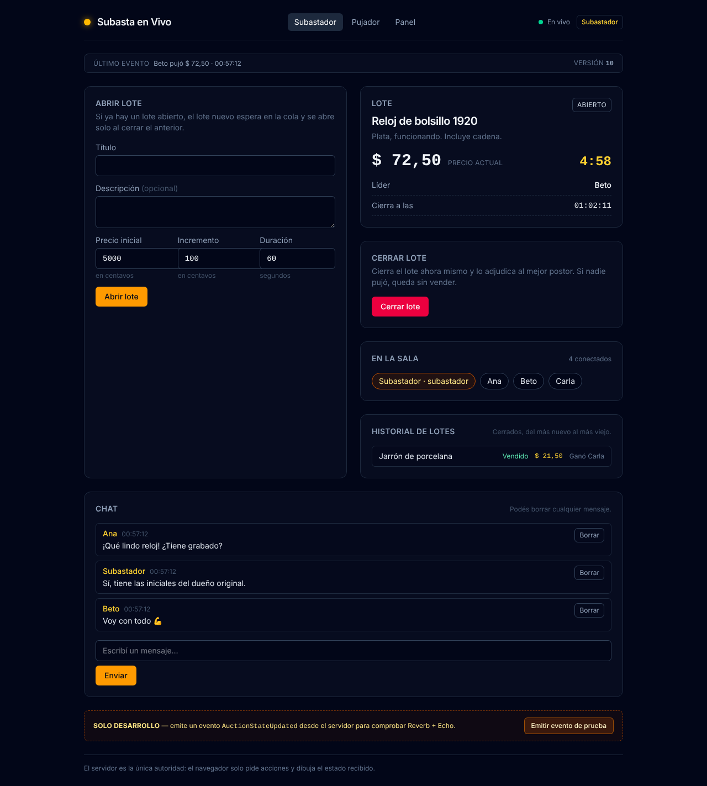
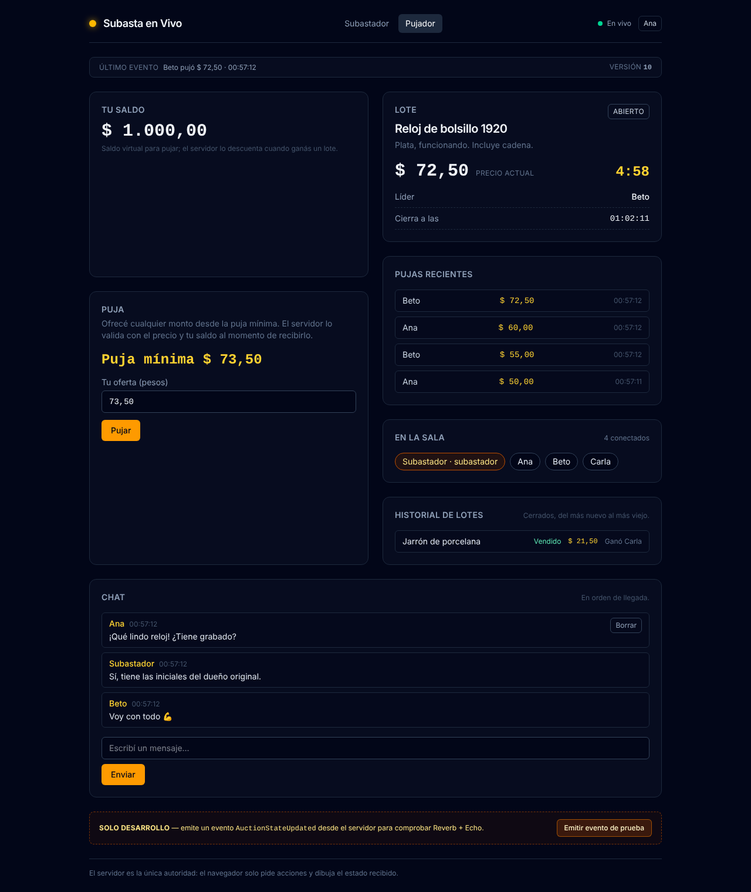
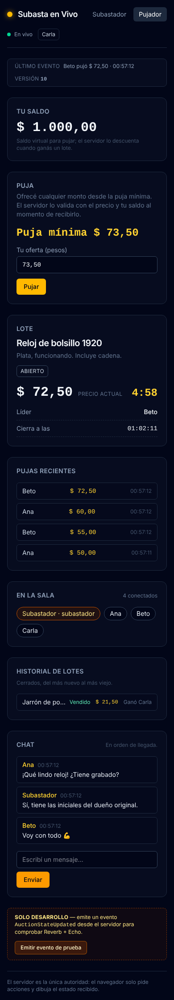
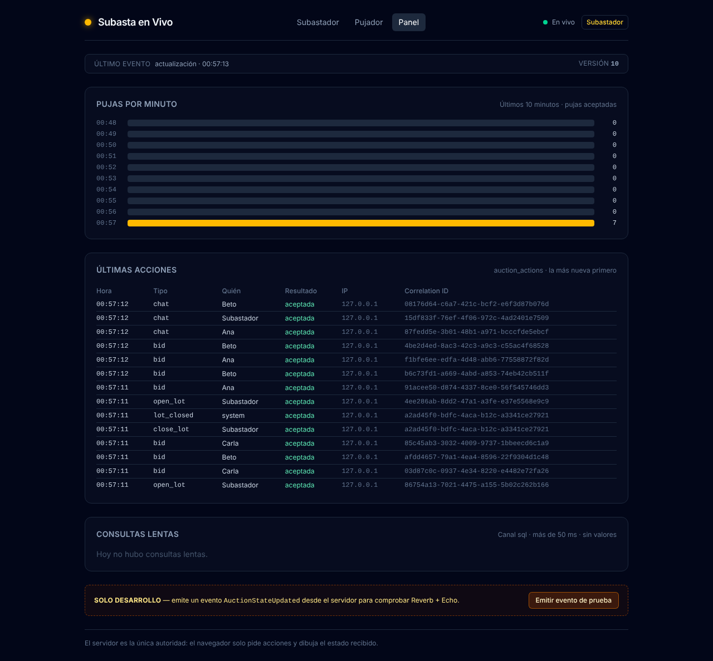

# Subasta en Vivo

[](https://github.com/Mauricio-Cardozo/subasta-en-vivo/actions/workflows/ci.yml)

Subasta en vivo para varias personas con roles asimétricos sobre una **sala compartida**. Un subastador publica lotes y los pujadores compiten por ellos. Todos ven el precio, el temporizador y el chat en tiempo real.

| Rol | Pantalla | Qué hace |
|---|---|---|
| **Subastador** (emisor) | `/emisor` | Abre lotes (título, precio inicial, incremento mínimo, duración), cierra un lote antes de tiempo y modera el chat. |
| **Pujador** (receptor) | `/receptor` | Ve el lote activo, el precio actual y el temporizador; puja; ve su saldo; chatea. |

Los nombres describen el rol de cada pantalla, no una limitación técnica: ambos envían acciones y ambos reciben eventos.

**Reglas de oro:**

1. El servidor es la única autoridad. El navegador pide acciones y dibuja el estado que le llega.
2. Se emite broadcast **después** del commit, nunca dentro de la transacción.
3. Reverb no reemplaza al endpoint de estado: el estado se carga y se recupera por HTTP.

## Capturas

Una sala con el subastador y tres pujadores conectados: un lote ya vendido en el historial, un lote en curso con pujas y el chat.

| Subastador (`/emisor`) | Pujador (`/receptor`) |
|---|---|
|  |  |

| Pujador en el celular | Panel del subastador (`/admin`) |
|---|---|
|  |  |

## Stack

- Laravel 12 · Reverb · Laravel Echo · Blade + JS
- MySQL/PostgreSQL en local y en CI (SQLite solo para arrancar)
- Logs JSON estructurados

## Instalación

```bash
composer install
npm ci
cp .env.example .env
php artisan key:generate
php artisan auction:setup        # claves de Reverb y PIN del subastador (muestra el PIN)
touch database/database.sqlite   # o usar MySQL/PostgreSQL configurando DB_* en .env
php artisan migrate --seed
npm run build                    # o npm run dev en desarrollo
```

`.env.example` no trae secretos, así que las claves de Reverb y el PIN vienen vacíos: sin ellos Echo no conecta y nadie entra como subastador. `auction:setup` genera solo los que falten (nunca pisa un valor ya configurado) e imprime el PIN. Si cambiás las claves, volvé a correr `npm run build`.

Levantar los tres procesos:

```bash
php artisan serve        # app en http://localhost:8000
php artisan reverb:start # websocket en el puerto 8080
npm run dev              # assets en desarrollo
```

Opcional: `php artisan schedule:work` corre `auction:close-expired` cada minuto, una red de seguridad que liquida los lotes vencidos que nadie volvió a consultar. Sin él, el cierre sigue funcionando en cuanto alguien interactúa (ver **Cerrar el lote**).

La configuración de Reverb (`REVERB_*` y `VITE_REVERB_*`) vive en `.env`; el repositorio solo incluye `.env.example` sin valores reales.

## Cómo probarlo

1. Levantá los tres procesos y abrí la app en **tres navegadores o ventanas privadas** (cada una es una sesión distinta).
2. En una, entrá a `/emisor` e iniciá sesión con el PIN (`AUCTION_HOST_PIN`). En las otras dos, entrá a `/receptor` y elegí un nombre (pujadores).
3. El panel **En la sala** de cada pantalla muestra a los tres conectados (canal de presencia). Cerrá una ventana y vas a ver cómo sale de la lista.
4. Como subastador, abrí un lote con una duración corta (por ejemplo 60 s). Si abrís otro mientras hay uno abierto, queda en la **cola**.
5. Como pujador, escribí tu oferta (el campo sugiere la puja mínima) y pujá: el precio y el temporizador cambian en todas las pantallas sin recargar. Probá una oferta por debajo del mínimo: el servidor la rechaza con el motivo.
6. Esperá a que venza (o cerrá el lote a mano): el lote aparece en el **historial** con su resultado, y el ganador ve el saldo descontado.
7. Probá el chat y su moderación, y el indicador de conexión (podés bajar Reverb y verlo pasar a `Sin conexión`).
8. Como subastador, abrí **Panel** (`/admin`): pujas por minuto, últimas acciones auditadas y consultas lentas.

Todo lo que se ve sale del servidor: si algo no llega por el canal, se recupera por HTTP al reconectar.

## Presentar en una notebook prestada (Windows, sin instalar nada)

`scripts/demo.ps1` baja PHP 8.4, Node.js 22 y Composer en versiones **portables** a una carpeta `demo-tools` junto al proyecto, prepara la app y la levanta. No toca el PATH del sistema ni el registro: el PATH se cambia solo en las ventanas que abre el script, y los cachés de Composer y npm quedan en `demo-tools`. Cada descarga se verifica con su SHA-256.

1. Creá una carpeta, por ejemplo `C:\demo-subasta`, y descomprimí ahí el zip del proyecto (*Code → Download ZIP* en GitHub).
2. Abrí PowerShell en la carpeta del proyecto y corré:

   ```powershell
   powershell -ExecutionPolicy Bypass -File .\scripts\demo.ps1 setup   # una vez: descarga, instala dependencias y muestra el PIN
   powershell -ExecutionPolicy Bypass -File .\scripts\demo.ps1 start   # abre la app, Reverb y tres navegadores
   powershell -ExecutionPolicy Bypass -File .\scripts\demo.ps1 stop    # corta la app y Reverb
   powershell -ExecutionPolicy Bypass -File .\scripts\demo.ps1 clean   # borra el proyecto y demo-tools (pide escribir BORRAR)
   ```

`-ExecutionPolicy Bypass` vale solo para ese comando. `start` abre `/emisor` en Chrome y `/receptor` en Chrome incógnito y en Edge: tres sesiones distintas (las ventanas de incógnito de Chrome comparten sesión entre sí). Reverb escucha en `127.0.0.1`, así que el firewall de Windows no pregunta nada.

- Si PHP no arranca y Windows menciona `VCRUNTIME140.dll`, falta el *Microsoft Visual C++ Redistributable* (x64); es lo único que se instalaría en el sistema.
- Si una descarga falla, el script dice qué bajar a mano y dónde guardarlo.
- `clean` no borra nada fuera del proyecto y `demo-tools`. Después borrá el zip de *Descargas*.

## Probar con un túnel (otros dispositivos)

Para que pujen desde celulares u otras redes hay que exponer **dos** puertos: la app (8000) y Reverb (8080). El navegador habla HTTP con la app y WebSocket con Reverb, así que los dos tienen que ser alcanzables desde afuera. Laravel, en cambio, publica en Reverb desde la misma máquina y sigue usando `localhost:8080`.

```bash
cloudflared tunnel --url http://localhost:8000   # → https://<tunel-app>.trycloudflare.com
cloudflared tunnel --url http://localhost:8080   # → https://<tunel-reverb>.trycloudflare.com
```

(Con ngrok es igual: un túnel por puerto.) En `.env`:

```dotenv
APP_URL=https://<tunel-app>.trycloudflare.com
TRUSTED_PROXIES=127.0.0.1             # confiar en las X-Forwarded-* del agente del túnel

REVERB_HOST="localhost"               # Laravel → Reverb, en la misma máquina
REVERB_PORT=8080
REVERB_SCHEME=http

VITE_REVERB_HOST=<tunel-reverb>.trycloudflare.com   # navegador → Reverb (wss://)
VITE_REVERB_PORT=443
VITE_REVERB_SCHEME=https
```

Después:

1. `npm run build` (no `npm run dev`: el servidor de Vite solo existe en `localhost:5173`; si quedó `public/hot`, borralo). Vite escribe los `VITE_*` al compilar, así que hay que recompilar cada vez que cambia el túnel.
2. `php artisan config:clear`, y levantar `php artisan serve` y `php artisan reverb:start`.
3. Abrir `https://<tunel-app>.trycloudflare.com` y revisar en DevTools → Network → WS que la conexión vaya a `wss://<tunel-reverb>…/app/<key>`.

Sin `TRUSTED_PROXIES` la página carga los assets con `http://` dentro de `https://` (el navegador los bloquea) y todos los visitantes comparten la IP `127.0.0.1`, así que los límites por IP (alta, PIN) se agotan entre todos. Fuera de un túnel o proxy dejalo vacío: confiar en cualquier `X-Forwarded-For` permitiría falsificar la IP.

## Tests y calidad

```bash
./vendor/bin/pint --test   # formateo (Laravel Pint)
php artisan test           # tests
```

La CI de GitHub Actions corre ambos (más `npm run build`) en cada PR y bloquea el merge en `main` si fallan. Además levanta un PostgreSQL y corre ahí la suite completa, incluidos los tests de concurrencia, que en SQLite se saltan porque ese motor no bloquea filas.

```bash
# Concurrencia real (opcional, en local):
docker run -d --name auction-pg -p 5432:5432 \
  -e POSTGRES_USER=auction -e POSTGRES_PASSWORD=secret -e POSTGRES_DB=auction_test postgres:16
DB_CONNECTION=pgsql DB_HOST=127.0.0.1 DB_PORT=5432 \
DB_DATABASE=auction_test DB_USERNAME=auction DB_PASSWORD=secret \
php artisan test --filter=ConcurrencyTest
```

## Flujo en tiempo real

```
navegador (/emisor, /receptor)              servidor                        clientes
        │                                       │                               │
        │  GET /emisor | /receptor ────────────►│  Blade (según la sesión)      │
        │  GET /auction/state ─────────────────►│  AuctionSnapshot              │
        │◄────── estado inicial (no-store) ─────│                               │
        │  Echo: channel('auction')             │                               │
        │  Echo: join('auction.presence') ─────►│  POST /broadcasting/auth      │
        │◄──────── WebSocket (Reverb :8080) ────│◄── AuctionStateUpdated ───────│
        │  dibuja snapshot (textContent)        │     (solo tras el commit)     │
        │  POST /join | /host/login             │                               │
        │  POST /auction/lots (solo subastador) │  AuctionService + lockForUpdate│
        │  POST /auction/lots/close (subastador)│  closeCurrentLot + lockForUpdate│
        │  POST /auction/bids (solo pujador) ──►│  placeBid + lockForUpdate     │
        │  POST /auction/chat (pujador o subastador)│  ChatService::post        │
        │  GET /auction/chat[?after_id=] ──────►│  ChatService::history         │
        │  DELETE /auction/chat/{id} (moderar) ►│  ChatService::delete          │
        │  DELETE /auction/lots/{id} (cola) ───►│  dequeue + lockForUpdate      │
        │  GET /admin (solo subastador) ───────►│  AdminDashboard (lectura)     │
```

- `window.Echo.channel('auction').listen('.AuctionStateUpdated', …)` — un único listener por página (`resources/js/auction.js`).
- `window.Echo.join('auction.presence')` — canal de presencia con la lista de conectados (`resources/js/presence.js`).
- El chat usa el mismo canal desde `resources/js/chat.js`: `.ChatMessagePosted` y `.ChatMessageDeleted`, y pide `GET /auction/chat` al cargar y al reconectar.
- El estado inicial se pide por **HTTP** (`GET /auction/state`); al reconectar también. Reverb no reemplaza al endpoint.
- El cliente ignora eventos con `version` menor o igual a la mostrada.
- El indicador del encabezado refleja el estado real de la conexión: `En vivo` (verde), `Conectando…`/`Reconectando…` (ámbar) y `Sin conexión` (rojo), en una región viva (`aria-live`). Es informativo: las acciones van por HTTP y no se bloquean si el WebSocket está caído.
- En `APP_ENV=local` aparece el botón **Emitir evento de prueba**, que llama a `POST /dev/broadcast` (ruta que no existe en otros entornos).

### Pujar

- El pujador **propone un monto** (RF-03): el campo acepta pesos con coma o punto, sugiere la puja mínima y el cliente lo convierte a centavos enteros (`amount_cents`) partiendo el texto, sin multiplicar decimales. El servidor decide si alcanza, bajo bloqueo; sin monto usa la puja mínima.
- El servidor valida en el orden del plan (4.1): lote cerrado → `bid_too_low` → `already_leading` → `insufficient_balance`. El primer fallo es el motivo.
- `action_id` es **opcional** (RNF-05). Con él, reintentar devuelve la respuesta original (misma puja, mismo rechazo) y la acción no se aplica dos veces; el mismo `action_id` con otro monto se rechaza con `action_id_reused`. Sin él, la puja se procesa y se audita, pero no es idempotente. El navegador manda uno por intento.
- Un 422 del servidor se muestra **tal cual** en el formulario; nunca se pinta como éxito.

### Cerrar el lote

- El subastador cierra a mano con `POST /auction/lots/close` (solo con lote abierto, idempotente por `action_id` igual que las pujas). Comparte el desenlace con el vencimiento: con pujas queda `sold` y se descuenta el saldo; sin pujas, `unsold`.
- El plazo es `[started_at, ends_at)`: una puja que llega **exactamente** en `ends_at` ya es tarde (`Lot::hasExpired()`).
- Cada cierre deja una fila `lot_closed` en `auction_actions` con la causa (`time` o `manual`), en la misma transacción que el cierre: una puja tardía se rechaza, pero el cierre que dispara queda confirmado, auditado y publicado.
- Red de seguridad opcional: `php artisan auction:close-expired` (programado cada minuto) usa el mismo cierre bajo bloqueo, así que nunca cierra dos veces.
- El **temporizador** del panel se calcula con el `remaining_ms` del servidor (no con el reloj del navegador) y se reancla con cada estado; al llegar a cero pide el estado para que el servidor liquide el lote. El navegador nunca simula el cierre.
- Una puja dentro de la **ventana final** corre el cierre (anti-sniping, con tope de extensiones); el panel lo refleja en el resumen del evento y en el contador reajustado.

### Chat

- Publican el **pujador** y el **subastador** (`POST /auction/chat`). El servidor decide autor y firma: el subastador se firma con `chat.host_name` porque no tiene fila de participante. El texto se recorta y se corta en `chat.max_length`.
- En vivo por el mismo canal `auction`: `ChatMessagePosted` para lo nuevo y `ChatMessageDeleted` para lo borrado. El cliente pide `GET /auction/chat` al cargar y **al reconectar** (Reverb no repite lo que pasó sin conexión) y ordena por `id`. Al reconectar recarga la ventana entera (no solo `after_id`) para enterarse también de los mensajes moderados mientras no había conexión.
- `GET /auction/chat?after_id={id}` devuelve solo los mensajes posteriores a ese id (6).
- Cada envío lleva un `action_id`: si la red reintenta, el servidor repite la respuesta en vez de duplicar el mensaje.
- **Moderar:** el subastador borra cualquier mensaje; el pujador, solo los suyos (una extensión respecto del plan). El servidor lo vuelve a comprobar (el botón del cliente es solo cosmético). El borrado es **lógico** (`deleted_at`): el mensaje sale del historial pero la fila queda para la auditoría.

### Cola de lotes

- Si el subastador abre un lote mientras hay otro abierto, el nuevo queda **en cola** (FIFO, hasta `auction.queue.max`). Al cerrarse el lote, tras una pausa de `auction.queue.gap_seconds` se abre solo el siguiente, sin cron: lo dispara la próxima lectura del estado (o `auction:close-expired`).
- El subastador puede quitar un lote de la cola (`DELETE /auction/lots/{id}`): queda `cancelled`, no se borra.

### En la sala (canal de presencia)

- Es el tercer tipo de canal (público, privado y **presencia**). `auction.presence` muestra en las dos pantallas quién está conectado y lo actualiza al entrar y salir (`here`, `joining`, `leaving`).
- No hay cuentas: antes de suscribirse, Echo pide permiso a `/broadcasting/auth` y el middleware `ResolveBroadcastIdentity` presenta la identidad de la **sesión** como usuario. Sin nombre ni rol de subastador la suscripción se rechaza (403); la subasta sigue en vivo por el canal público.
- Cada miembro expone un **seudónimo**, el nombre y el rol; nunca ids internos, saldos ni la IP. Varias pestañas de la misma sesión cuentan como un solo miembro.

### Historial de lotes

- Los lotes ya cerrados (vendidos, sin vender o cancelados) se listan del más nuevo al más viejo en las dos pantallas, con título, estado, precio final y ganador (RF-13).
- Viaja dentro del **mismo snapshot público** (acotado por `auction.history.limit`), así que aparece al cargar por HTTP y se actualiza en vivo cuando un lote se cierra: no hay un endpoint aparte y el cliente no calcula nada.
- Igual que el resto del snapshot, solo expone campos públicos: nunca ids internos, sesiones ni saldos ajenos.

## Identidad

No hay cuentas ni contraseñas: la identidad vive en la **sesión del servidor**.

- **Pujador:** `POST /join` con un nombre validado (longitud, caracteres, reservado `Subastador` y único sin distinguir mayúsculas) guarda un `participants` ligado a la sesión y le asigna el saldo virtual.
- **Subastador:** `POST /host/login` compara el PIN de `AUCTION_HOST_PIN` en tiempo constante. Sin PIN configurado el acceso **siempre** falla. El rol queda en la sesión, nunca en el navegador.
- El vínculo navegador↔participante se guarda hasheado (`sha256(id de sesión | app key)`) en `participants.session_id` y nunca viaja al cliente.
- La clave de idempotencia (`actor_key`) es el **participante** (`participant:{id}`), no el hash de la sesión: el id de sesión se regenera al cambiar de identidad y el participante es la identidad durable. Para el subastador, que no tiene fila de participante, se usa un token durable de la sesión (`host:{token}`).
- Al cambiar de identidad (unirse o loguearse como subastador) la sesión se invalida: el navegador no arrastra privilegios del rol anterior.
- Los middleware `participant` y `host` protegen las acciones; el servidor responde 403 sin el rol.

## Arquitectura (resumen)

- Toda acción que modifica estado es atómica: transacción + `lockForUpdate` sobre la fila de la sala (`auction_rooms`), con un único orden de bloqueo.
- El servidor valida todo: montos, saldo, tiempo y rol. Ningún valor económico lo decide el cliente; los montos son enteros en centavos. Las acciones devuelven un `ActionResult`: un rechazo de negocio es un 422 con motivo, nunca una excepción ni un evento.
- `AuctionSnapshot` es el serializador único del estado público: lo comparten el evento y `GET /auction/state`, y solo expone nombres y montos (nunca ids internos, sesiones ni saldos ajenos). Incluye las últimas pujas del lote abierto y el historial de lotes cerrados (RF-10, RF-13).
- El broadcast (`AuctionStateUpdated`, canal público `auction`) se emite solo después del `commit`. Un rechazo no emite evento de éxito: responde 422 y se audita.
- Cierre perezoso sin cron: el vencimiento se resuelve dentro de cada acción y de `GET /auction/state` (con `Cache-Control: no-store` e idempotente); el subastador puede cerrar antes con `POST /auction/lots/close`.
- `version` es la versión del estado persistido de la sala: sube una vez por transición confirmada y permite ignorar eventos desordenados. El chat no la usa: se ordena por `id`.
- Balance y reglas en `config/auction.php` (incluidos los límites de peticiones); la lógica de subasta vive en `app/Services/AuctionService.php`; los controladores son delgados.
- Concurrencia real probada contra PostgreSQL en la CI (`tests/Feature/ConcurrencyTest.php`): sin `lockForUpdate` dos pujas simultáneas perderían una actualización, dos cierres adjudicarían dos veces o una puja y un cierre dejarían el lote incoherente.
- Idempotencia por `action_id` (opcional) con restricción única `(actor_key, action_id)`; reintentar repite la respuesta original y reusar el id con otro contenido se rechaza (`action_id_reused`). El registro vive en `App\Services\ActionIdempotency` y lo comparten las pujas, la apertura, el cierre y el chat; la `actor_key` del subastador es un token durable de la sesión, no el id de sesión (que se regenera).

## Observabilidad

- **Auditoría persistente (`auction_actions`, RF-15):** cada acción (puja, apertura, cierre, baja de la cola, mensaje, borrado), aceptada o rechazada, deja una fila con `type`, `participant_id`, `actor_key`, `ip`, `payload` (sin secretos: del chat se guarda el largo, no el texto), `accepted`, `reason`, la respuesta (`result`) y el `correlation_id`. Los cierres quedan como `lot_closed` con su causa. La misma fila sirve para la idempotencia.
- **Logs en JSON:** una línea por registro, rotación diaria y `LOG_DAILY_DAYS` archivos, en cuatro canales:

  | Canal | Qué guarda |
  |---|---|
  | `auction` | La aplicación y las transiciones: `lot.opened`, `bid.accepted`, `lot.extended`, `lot.closed` (escritas recién tras el commit). |
  | `audit` | Cada acción con su resultado (`accepted`/`rejected`/`replayed`/`in_progress`), incluido el login del subastador (el **PIN nunca se registra**). |
  | `broadcast` | `broadcast.sent` por cada evento que Reverb aceptó (evento, canales, payload, origen) y `broadcast.failed` por cada fallo. "Aceptado por Reverb" no es "recibido por los navegadores". |
  | `sql` | `sql.slow`: consultas de más de `SQL_SLOW_MS` (50 ms), con sus `?` y **sin los valores**. |

- **`correlation_id` de punta a punta:** el middleware `AssignCorrelationId` toma `X-Correlation-ID` si trae un valor seguro (o genera un UUID), lo comparte con **todos** los registros (`Log::shareContext`) y lo devuelve en la cabecera de la respuesta. La misma petición se sigue en `audit`, `auction`, `broadcast`, `sql` y en `auction_actions`. El valor entrante se valida (`[A-Za-z0-9._-]`, ≤64) para no inyectar en los registros.
- Los tests escriben sus logs aparte (`LOG_DIR=storage/logs/testing` en `phpunit.xml`).
- **Panel `/admin`** (solo subastador): pujas por minuto, últimas acciones de `auction_actions` y consultas lentas del día.

### Leer los logs con `jq`

```bash
# Seguir una petición por todos los canales (el id sale de la cabecera X-Correlation-ID)
jq -c --arg id "<correlation_id>" 'select(.context.correlation_id == $id) | {message, context}' storage/logs/*.log

# Acciones rechazadas y su motivo
jq -c 'select(.context.outcome == "rejected") | {message, reason: .context.reason, at: .datetime}' storage/logs/audit-*.log

# Eventos entregados a Reverb: hora, evento y qué petición los originó
jq -r 'select(.message == "broadcast.sent") | "\(.datetime[11:19]) \(.context.event) \(.context.origin)"' storage/logs/broadcast-*.log

# Fallos de difusión (Reverb caído)
jq -c 'select(.message == "broadcast.failed") | {event: .context.event, error: .context.exception}' storage/logs/broadcast-*.log

# Transiciones de la subasta
jq -c 'select(.message | test("^(lot|bid)\\.")) | {message, context}' storage/logs/auction-*.log

# Las 10 consultas más lentas
jq -s 'map(select(.message == "sql.slow")) | sort_by(-.context.ms) | .[:10] | map({ms: .context.ms, sql: .context.sql})' storage/logs/sql-*.log
```

## Estructura

```
app/
  Events/            # AuctionStateUpdated, ChatMessagePosted, ChatMessageDeleted
  Console/Commands/  # CloseExpiredLots (auction:close-expired)
  Http/Controllers/  # AuctionController, ParticipantController, HostAuthController, BidController, ChatController, AdminController (delgados)
  Http/Middleware/   # EnsureHost, EnsureParticipant, AssignCorrelationId, ResolveBroadcastIdentity
  Http/Requests/     # JoinRequest, HostLoginRequest, OpenLotRequest, CloseLotRequest, PlaceBidRequest, ChatMessageRequest
  Models/            # AuctionRoom, Lot, Participant, Bid, AuctionAction, ChatMessage
  Services/          # AuctionService, AuctionSnapshot, ChatService, SessionIdentity, ActionIdempotency, AuditLogger, AdminDashboard
  Support/           # ActionResult, Money, CorrelationId, RequestContext, Broadcasting/ResilientBroadcaster
config/auction.php, config/trustedproxy.php
routes/channels.php        # autorización del canal de presencia
resources/views/auction/   # layout, emisor, receptor, admin, partials/{lot,history,chat,presence}
resources/js/              # auction.js, chat.js, presence.js, action-id.js
tests/Feature/, tests/Unit/   # ConcurrencyTest solo corre con PostgreSQL/MySQL
```

## Hitos

- [x] **Hito 0 — Preparación:** repo, Laravel 12 + Reverb + Echo + Vite, Pint, CI.
- [x] **Hito 1 — Dos pantallas conectadas:** `/emisor` y `/receptor` con un evento de prueba.
- [x] **Hito 2 — Sala, lotes y estado compartido:** esquema y balance, identidad (alta + PIN), apertura de lote bajo bloqueo y estado público por HTTP.
- [x] **Hito 3 — Pujas y concurrencia:** esquema de pujas e idempotencia, `placeBid` bajo bloqueo, `POST /auction/bids`, pujas en el snapshot, UI de puja y tests de concurrencia real contra PostgreSQL.
- [x] **Hito 4 — Temporizador, cierre y anti-sniping:** cierre por vencimiento con adjudicación y descuento de saldo, anti-sniping, cierre manual del subastador idempotente, temporizador y resultado en las pantallas, y tests de concurrencia del cierre.
- [x] **Hito 5 — Chat:** esquema de mensajes; `POST /auction/chat` para pujador y subastador con `ChatMessagePosted` tras el commit; historial por `GET /auction/chat` y moderación por `DELETE` con `ChatMessageDeleted`; panel compartido en vivo (historial por HTTP al cargar y al reconectar) y tests de concurrencia del chat contra PostgreSQL.
- [x] **Hito 6 — Logging y trazabilidad:** canales `auction`/`audit` en JSON con rotación diaria, `correlation_id` de punta a punta (`X-Correlation-ID` en la respuesta) y auditoría de acciones con el `action_id` y el resultado.
- [x] **Hito 7 — Pulido y entrega:** historial de lotes cerrados en el snapshot público, estados de conexión con color y región viva, README de entrega y release `v1.0.0`.

**Versión `v1.1.0`** (cierra el plan completo y la consigna de canales):

- [x] Cola de lotes con auto-avance (opcional del Hito 7).
- [x] Túnel para probar desde otros dispositivos y borde exacto de `ends_at`.
- [x] Monto propuesto por el pujador (RF-03) y orden de validación de 4.1.
- [x] `action_id` opcional y `action_id_reused` (RNF-05, 4.7).
- [x] Auditoría persistente en `auction_actions` (RF-15), canales `broadcast` y `sql` (RF-16, RF-17) y comandos `jq`.
- [x] Chat con borrado lógico, `after_id` e idempotencia (6).
- [x] `auction:close-expired` (4.4) y panel `/admin` (RF-18).
- [x] Canal de presencia: quién está en la sala.
- [x] `auction:setup` para instalar en una máquina nueva, horas en 24 horas y capturas en el README.

Cada hito es un milestone en GitHub; cada tarea, un issue; cada issue, una rama y un PR.

## Git

- GitHub Flow: `main` siempre estable (PR obligatorio, CI verde); una rama por issue (`feat/12-place-bid-endpoint`).
- Commits atómicos con [Conventional Commits](https://www.conventionalcommits.org/).
- PRs chicos (ideal <300 líneas), con `Closes #n` para cerrar el issue al mergear.
- Tags semánticos por hito (`v0.1.0`, `v0.2.0`, `v0.3.0`, …) con su resumen en [CHANGELOG.md](CHANGELOG.md).

## Licencia

[MIT](LICENSE)
